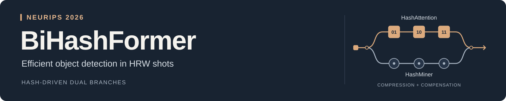
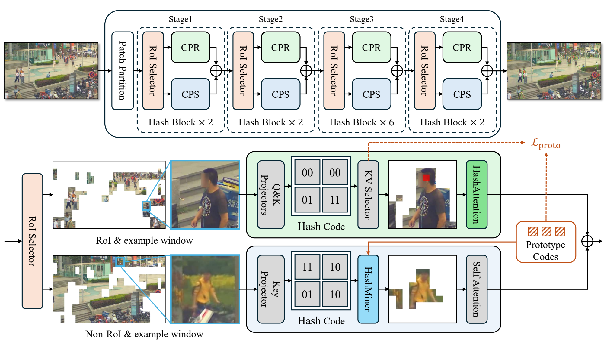

<div align="center">



<h2>Hash-Driven Dual-Branch Transformer for Efficient Object Detection in HRW Shots</h2>

<p>Jingchen Huang<sup>*</sup>, Wenxi Li<sup>*</sup>, Chenyang Lyu<sup>*</sup>,<br>Moran Liu, Haozhe Lin, Yuchen Guo<sup>†</sup></p>
<p><sub><sup>*</sup> Equal contribution &nbsp; <sup>†</sup> Corresponding author</sub></p>

<p>
  <a href="https://openreview.net/forum?id=VT9aN17Fbk"></a>
  <a href="docs/validation.md"></a>
  <a href="docs/validation.md"></a>
  <a href="LICENSE"></a>
</p>

<p>
  <a href="#overview">Overview</a> &nbsp;·&nbsp;
  <a href="#paper-results">Results</a> &nbsp;·&nbsp;
  <a href="#quick-start">Quick start</a> &nbsp;·&nbsp;
  <a href="#training">Training</a> &nbsp;·&nbsp;
  <a href="#evaluation">Evaluation</a> &nbsp;·&nbsp;
  <a href="#citation">Citation</a>
</p>

</div>

## Overview

BiHashFormer allocates computation through two branches. The compression branch uses query-specific hash routing within selected windows. The compensation branch retrieves foreground tokens from the remaining windows using learned prototypes.

<p align="center">
  
  <br><sub>Architecture overview from the paper. <a href="docs/implementation.md">Read the method and training details →</a></sub>
</p>

| Component | What it does |
| :--- | :--- |
| **RoI Selector** | Predict a per-image window budget and route informative windows. |
| **Compression branch** | Let each query attend to its nearest half of the keys in a learned Hamming space. |
| **Compensation branch** | Use three foreground prototypes and HashMiner to retrieve tokens outside the RoI. |

## Paper results

PANDA results with DINO, reported in **Table 1 of the paper**. AP values are percentages; GFLOPs cover the backbone and neck.

| Model | AP<sub>50</sub> ↑ | AP<sub>small</sub> ↑ | AP<sub>medium</sub> ↑ | AP<sub>large</sub> ↑ | GFLOPs ↓ |
| :--- | ---: | ---: | ---: | ---: | ---: |
| DINO + Swin-T | 60.6 | 36.7 | 61.2 | 64.9 | 132.84 |
| DINO + SparseFormer | 78.0 | 50.8 | 78.1 | 82.3 | 75.71 |
| **DINO + BiHashFormer** | **81.0** | **59.1** | **79.2** | **84.7** | **47.31** |

The repository includes the backbone, DINO integration, training configurations, and PANDA inference/evaluation tools. **Trained weights are not included.** See the [validation record](docs/validation.md) for software checks.

## Quick start

The validated environment uses **Python 3.10 · PyTorch 2.1 / CUDA 11.8 · MMCV 2.1 · MMEngine 0.10.7 · MMDetection 3.3**.

```bash
git clone https://github.com/Purecoo00/BiHashFormer.git
cd BiHashFormer

conda create -n bihashformer python=3.10 -y
conda activate bihashformer
pip install torch==2.1.0 torchvision==0.16.0 --index-url https://download.pytorch.org/whl/cu118
pip install mmcv==2.1.0 -f https://download.openmmlab.com/mmcv/dist/cu118/torch2.1/index.html
pip install -r requirements.txt
pip install -e . --no-deps
```

Use the MMCV wheel matching your PyTorch/CUDA build. DINO requires the compiled deformable-attention operator provided by `mmcv`.

Prepare COCO-format PANDA patches using the [data preparation guide](docs/data.md), then update the dataset paths in [the dataset configuration](configs/_base_/datasets/panda_detection.py).

## Training

The [released configuration](configs/dino/dino_bihashformer_t_8xb1_36e_panda.py) uses **36 epochs** and **one image per GPU**. This launcher uses 8 GPUs:

```bash
bash scripts/dist_train.sh configs/dino/dino_bihashformer_t_8xb1_36e_panda.py 8
```

<details>
<summary><b>Single-GPU training and resuming</b></summary>

```bash
# Train on one GPU.
python tools/train.py configs/dino/dino_bihashformer_t_8xb1_36e_panda.py

# Resume the latest checkpoint in a work directory.
python tools/train.py configs/dino/dino_bihashformer_t_8xb1_36e_panda.py \
  --work-dir work_dirs/bihashformer --resume
```

</details>

## Evaluation

```bash
bash scripts/dist_test.sh configs/dino/dino_bihashformer_t_8xb1_36e_panda.py path/to/checkpoint.pth 8
```

The standard configuration reports **patch-level COCO metrics**. For full-frame PANDA metrics, use tiled inference, merge detections in full-image coordinates, and apply the PANDA evaluator:

```bash
python tools/infer_tiles.py \
  configs/dino/dino_bihashformer_t_8xb1_36e_panda.py path/to/checkpoint.pth \
  --ann-file data/panda/full_frame_test.json \
  --image-root data/panda/full_frames \
  --out predictions.json --device cuda:0

python tools/evaluate_panda.py data/panda/full_frame_test.json predictions.json
```

See the [full-frame evaluation guide](docs/data.md#full-frame-inference-and-evaluation) for tiling options and PANDA-specific area ranges. Patch-level COCO scores and full-frame PANDA scores measure different evaluation settings.

## Validation

```bash
python -m pytest tests -q
python tools/smoke_test.py --device cuda:0
```

The synthetic smoke test runs an optimizer step and DINO inference. Tests cover binary hashing, query-specific key routing, prototype retrieval, masks, gradients, and PANDA evaluation. These checks validate code execution and training integration. Paper accuracy and runtime measurements are separate benchmark results.

## Code guide

| Entry | Source |
| :--- | :--- |
| Backbone and both branches | [`bihashformer.py`](bihash_former/models/backbones/bihashformer.py) |
| Detector and auxiliary losses | [`bihash_dino.py`](bihash_former/models/detectors/bihash_dino.py) |
| Training configuration | [`dino_bihashformer_t_8xb1_36e_panda.py`](configs/dino/dino_bihashformer_t_8xb1_36e_panda.py) |
| Tiled inference | [`infer_tiles.py`](tools/infer_tiles.py) |
| PANDA evaluation | [`evaluate_panda.py`](tools/evaluate_panda.py) |
| Environment and checks | [Validation record](docs/validation.md) |

## Citation

If you use BiHashFormer in your research, please cite:

```bibtex
@inproceedings{huang2026bihashformer,
  title={BiHashFormer: Hash-Driven Dual-Branch Transformer for Efficient Object Detection in HRW Shots},
  author={Huang, Jingchen and Li, Wenxi and Lyu, Chenyang and Liu, Moran and Lin, Haozhe and Guo, Yuchen},
  booktitle={Advances in Neural Information Processing Systems},
  year={2026}
}
```

## Acknowledgments and license

Built with [MMDetection](https://github.com/open-mmlab/mmdetection), MMCV, and MMEngine. We thank [liwenxi/SparseFormer](https://github.com/liwenxi/SparseFormer) for the sparse detection framework and PANDA evaluator. See [NOTICE](NOTICE) for attribution. Code is distributed under the [Apache License 2.0](LICENSE).

---

<p align="center">
  <b>Related work</b> &nbsp; <a href="https://github.com/Purecoo00/ElasticFormer">ElasticFormer</a> &nbsp;·&nbsp;
  <a href="https://github.com/liwenxi/SparseFormer">SparseFormer</a>
  <br><sub>Efficient object detection in high-resolution, wide-field images.</sub>
</p>
